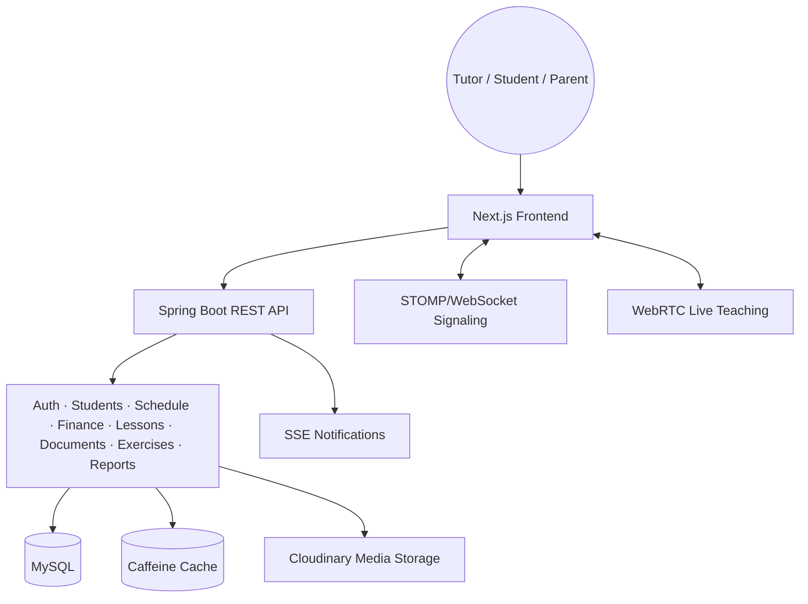

# Tutor Pro

🌐 **English** | [Tiếng Việt](README.vi.md)

### Tutor management and learning platform

Tutor Pro is a full-stack platform for tutors who want to manage teaching operations in one place: student records, schedules, tuition, documents, lessons, assessments, reports, and online teaching.

[🌐 Live Demo](https://tutorpro.id.vn)

## What is Tutor Pro?

Tutor Pro brings the recurring work of a tutor into a single workspace. Tutors can organize students and parents, create recurring schedules, track completed and unpaid sessions, prepare lessons, share documents, run assessments, generate reports, and open online teaching rooms.

The application has separate tutor, student, and admin surfaces, with role-based access control and responsive interfaces for desktop and mobile.

## Features

### Operations

- **Overview** — dashboard KPIs, revenue trends, student status, notifications, and monthly details.
- **Finance** — monthly tuition tracking, payment status, debt follow-up, student finance cards, bulk actions, and tuition reports.
- **Settings** — tutor profile, account preferences, notification settings, recurring schedule configuration, and application appearance.

### Academic management

- **Students & Parents** — student profiles, parent contacts, learning schedules, tuition rates, notes, and financial summaries.
- **Classes** — organize students into classes and manage class-related learning activities.

### Teaching

- **Schedule** — monthly calendar, list view, source filters, recurring schedules, session status, drag-and-drop interactions, lesson editor, payment state, and session details.
- **Documents** — document library with categories, uploads, previews, assignments, and downloads.
- **Lessons** — lesson library, course and lesson organization, lesson detail pages, learning materials, and reusable lesson content.
- **Live teaching** — online teaching rooms with WebRTC media, synchronized whiteboard state, chat, session controls, and in-browser recording support.

### Assessment and reporting

- **Reports** — progress summaries, attendance and session information, tutor-written feedback, monthly tuition reports, and PDF export.
- **Assessment** — exercise authoring, document-based question import, multiple-choice and essay workflows, grading, autosave, timers, and submission handling.

### Recent product updates

- Shared frontend global styles and refreshed responsive landing pages.
- Calendar list view alongside the monthly calendar view.
- Lesson editor and richer lesson detail flows.
- Document library and monthly student reporting.
- Live teaching lobby and media streaming improvements.
- Global amount visibility toggle for financial values in the interactive UI. Exported PDF/image reports remain readable with full amounts.

## Engineering Highlights

### 1. Bulk calendar generation

Recurring schedules can generate a group of sessions in one workflow. The backend contains calendar generation and finance-related services, while the frontend provides recurring scheduling, calendar views, status handling, and monthly reports.

### 2. Event-driven notifications with SSE

The notification module uses Spring application events and Server-Sent Events. The frontend includes an SSE hook and notification UI so clients can receive updates without repeatedly polling the API.

### 3. Interactive live teaching room

The live-room module uses WebRTC for media, STOMP/WebSocket signaling, synchronized whiteboard state, chat, device handling, and browser-side recording.

### 4. Assessment workflow with autosave

The exercise and submission modules support question management, imports, timed attempts, autosave, auto-submit behavior, tutor grading, and student submission views.

### 5. Responsive calendar and lesson workflows

The calendar supports monthly and list views, filtering, recurring schedules, session editing, payment state changes, online/offline conversion, detail modals, and responsive header actions.

### 6. Shared UI foundations

The frontend uses shared contexts, responsive header utilities, global styles, reusable UI primitives, TanStack Query, and feature-level components. Financial values are rendered through a shared visibility-aware component instead of changing stored data.

## Tech Stack

```text
Frontend          Next.js 16 · React 19 · TypeScript
                  Tailwind CSS 4 · Radix UI · Lucide React
                  TanStack Query v5 · Framer Motion
                  React Hook Form · Zod · Recharts · @dnd-kit

Backend           Spring Boot 3.4.1 · Java 21
                  Spring Web · Spring Security · Spring Data JPA
                  MySQL 8 · H2 for runtime/test scenarios
                  Caffeine Cache · Spring Events · Actuator
                  iText PDF · Apache POI · Bucket4j

Communication     REST · JWT · OAuth2 · SSE
                  WebSocket/STOMP · WebRTC P2P

Infrastructure    Docker Compose · Nginx
                  Cloudinary · Maven Wrapper · npm
```

## System Architecture



## Security

- JWT authentication with refresh-token support.
- OAuth2 login configuration for Google.
- Role and permission checks across protected backend endpoints.
- Frontend Zod validation and backend Jakarta Validation.
- Bucket4j rate limiting for protected flows.
- Audit-log module for sensitive administrative actions.
- CORS and frontend/backend URL configuration for local and production deployments.

## Requirements

- Node.js 20+
- npm
- Java 21
- Maven Wrapper included in `backend`
- Docker and Docker Compose for containerized development or production
- MySQL 8 when running the backend outside Docker

## Local Development

### Option A: run with Docker Compose

1. Copy the environment template:

   ```bash
   cp .env.example .env
   ```

2. Fill in the required database, API URL, OAuth, storage, and mail values.

3. Start the development stack:

   ```bash
   docker compose up --build
   ```

4. Open:

   - Frontend: http://localhost:3000
   - Backend: http://localhost:8080
   - MySQL: localhost:3306

The development compose file mounts the frontend source and runs `npm run dev`. The backend is built from `backend/Dockerfile`.

### Option B: run services directly

Frontend:

```bash
cd frontend
npm install
npm run dev
```

Backend:

```bash
cd backend
./mvnw spring-boot:run
```

On Windows, use `mvnw.cmd` instead of `./mvnw`.

## Production Deployment

The production compose file expects pre-built Docker images for the frontend and backend, a MySQL service, and an Nginx reverse proxy.

```bash
docker compose -f docker-compose.prod.yml up -d
```

Before starting production:

1. Copy `.env.example` to `.env` on the server.
2. Set `DOCKERHUB_USERNAME` and the production image configuration.
3. Set database, JWT, OAuth2, frontend/backend URL, Cloudinary, mail, and online-session secrets.
4. Configure TLS certificates mounted by `docker-compose.prod.yml`.
5. Ensure `NEXT_PUBLIC_API_URL` points to the public backend URL before building the frontend image.

For the complete server checklist, see [`DEPLOYMENT_GUIDE.md`](DEPLOYMENT_GUIDE.md).

## Environment Variables

The root `.env.example` is the source template for Docker deployment. Common variables include:

| Variable | Purpose |
|:--|:--|
| `MYSQL_DATABASE` | MySQL database name |
| `MYSQL_ROOT_PASSWORD` | Development database root password |
| `MYSQL_USERNAME` / `MYSQL_PASSWORD` | Production database user |
| `NEXT_PUBLIC_API_URL` | Backend URL used by the browser |
| `BACKEND_URL` | Backend public URL and OAuth callback base |
| `FRONTEND_URL` | Allowed frontend origin(s) in production |
| `GOOGLE_CLIENT_ID` / `GOOGLE_CLIENT_SECRET` | Google OAuth2 |
| `JWT_SECRET` / `APP_JWT_SECRET` and expiration values | JWT signing and token lifetime; the production compose file passes `APP_JWT_SECRET` |
| `CLOUDINARY_CLOUD_NAME` / `CLOUDINARY_API_KEY` / `CLOUDINARY_API_SECRET` | Media storage |
| `SPRING_MAIL_*` / `MAIL_PASSWORD` | Email delivery |
| `ONLINE_SESSION_JWT_SECRET` | Online teaching session security |
| `DOCKERHUB_USERNAME` | Production image namespace |
| `JAVA_OPTS` | Optional JVM memory and runtime options |

Do not commit `.env` or real credentials.

## Repository Structure

```text
Tutor-Pro/
├── frontend/
│   ├── app/                 # Next.js routes and layouts
│   ├── components/          # Shared UI and application components
│   ├── contexts/            # Auth, UI, theme, and shared visibility state
│   ├── features/            # Dashboard, calendar, finance, students, learning, etc.
│   ├── hooks/               # Reusable frontend hooks
│   ├── lib/                 # API clients, services, types, and utilities
│   ├── providers/           # React Query and application providers
│   └── __tests__/           # Frontend tests
├── backend/
│   ├── src/main/java/       # Spring Boot modular backend
│   ├── src/main/resources/  # Application configuration and fonts
│   ├── src/test/            # Backend tests
│   └── pom.xml              # Maven dependencies and build
├── docker-compose.yml        # Development stack
├── docker-compose.prod.yml   # Production stack
├── nginx.prod.conf           # Production reverse proxy
├── scripts/                  # Local and backup scripts
└── .env.example              # Environment template
```

## Testing and Quality Checks

Frontend:

```bash
cd frontend
npm run lint
npm run test
```

Backend:

```bash
cd backend
./mvnw test
```

Use `mvnw.cmd` on Windows.

## Suggested Screenshots and GIFs

Recommended screenshots for the repository page:

1. Overview dashboard with KPI cards and revenue chart.
2. Finance screen showing monthly tuition and debt tracking.
3. Students & Parents cards with financial summary.
4. Calendar monthly view with the list view toggle.
5. Lesson editor/detail modal.
6. Online teaching room with whiteboard and video panels.
7. Assessment attempt and tutor grading view.
8. PDF tuition report preview.

GIF placeholders (fill these directly on GitHub if needed):

- `<!-- GIF: calendar recurring-session generation -->`
- `<!-- GIF: lesson editor workflow -->`
- `<!-- GIF: live teaching room -->`
- `<!-- GIF: amount visibility toggle -->`

## License and Contact

This repository is maintained as a personal product project. Review the repository files and deployment documentation before deploying it for production use.

Built by [Tôn Quỳnh Long](https://github.com/longtq2501).

---

If Tutor Pro is useful to you, consider leaving a star on GitHub.
