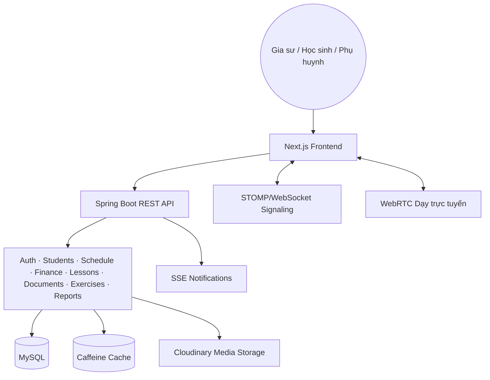

# Tutor Pro

🌐 [English](README.md) | **Tiếng Việt**

### Nền tảng quản lý gia sư và học tập

Tutor Pro là nền tảng full-stack giúp gia sư quản lý công việc giảng dạy trong một nơi: hồ sơ học sinh, lịch dạy, học phí, tài liệu, bài giảng, khảo thí, báo cáo và lớp học trực tuyến.

[🌐 Live Demo](https://tutorpro.id.vn)

## Tutor Pro là gì?

Tutor Pro tập trung các công việc lặp lại của gia sư vào một không gian làm việc duy nhất. Gia sư có thể quản lý học sinh và phụ huynh, tạo lịch lặp, theo dõi buổi đã dạy và công nợ, soạn bài, chia sẻ tài liệu, tổ chức khảo thí, xuất báo cáo và mở phòng học trực tuyến.

Ứng dụng có các khu vực riêng cho gia sư, học sinh và quản trị viên, đi kèm phân quyền theo vai trò và giao diện responsive cho desktop lẫn mobile.

## Tính năng

### Vận hành

- **Tổng Quan** — KPI, xu hướng doanh thu, trạng thái học sinh, thông báo và chi tiết theo tháng.
- **Tài Chính** — theo dõi học phí theo tháng, trạng thái thanh toán, công nợ, thẻ tài chính học sinh, thao tác hàng loạt và báo cáo học phí.
- **Cài đặt** — hồ sơ gia sư, tùy chọn tài khoản, thông báo, lịch lặp và giao diện ứng dụng.

### Quản lý học vụ

- **Học Sinh & PH** — hồ sơ học sinh, liên hệ phụ huynh, lịch học, học phí theo giờ, ghi chú và tổng hợp tài chính.
- **Lớp học** — tổ chức học sinh theo lớp và quản lý các hoạt động học tập liên quan.

### Giảng dạy

- **Lịch dạy** — lịch tháng, chế độ danh sách, bộ lọc nguồn, lịch lặp, trạng thái buổi học, thao tác kéo thả, chỉnh sửa buổi học, trạng thái thanh toán và modal chi tiết.
- **Tài liệu** — thư viện tài liệu, phân loại, tải lên, xem trước, gán tài liệu và tải xuống.
- **Bài giảng** — thư viện bài giảng, tổ chức khóa học và bài học, trang chi tiết, học liệu và nội dung có thể tái sử dụng.
- **Dạy trực tuyến** — phòng học WebRTC, đồng bộ bảng trắng, chat, điều khiển buổi học và ghi hình trong trình duyệt.

### Đánh giá và báo cáo

- **Báo cáo** — tổng hợp tiến độ, thông tin chuyên cần và buổi học, nhận xét do gia sư viết, báo cáo học phí theo tháng và xuất PDF.
- **Khảo thí** — tạo bài tập, nhập câu hỏi từ tài liệu, quy trình trắc nghiệm và tự luận, chấm bài, tự lưu, hẹn giờ và nộp bài.

### Cập nhật gần đây

- Bộ global styles dùng chung và landing page responsive được làm mới.
- Chế độ danh sách bên cạnh lịch tháng.
- Lesson editor và luồng chi tiết bài học phong phú hơn.
- Thư viện tài liệu và báo cáo học sinh theo tháng.
- Lobby dạy trực tuyến và các cải tiến streaming media.
- Nút ẩn/hiện số tiền dùng chung cho các giá trị tài chính trên giao diện tương tác. Báo cáo PDF/image vẫn hiển thị đầy đủ số tiền.

## Điểm nhấn kỹ thuật

### 1. Sinh lịch hàng loạt

Lịch lặp có thể tạo nhiều buổi học trong một quy trình. Backend có các service sinh lịch và tài chính; frontend cung cấp lịch lặp, nhiều chế độ xem lịch, xử lý trạng thái và báo cáo theo tháng.

### 2. Thông báo theo sự kiện với SSE

Module thông báo sử dụng Spring application events và Server-Sent Events. Frontend có SSE hook và giao diện thông báo để nhận cập nhật mà không phải liên tục polling API.

### 3. Phòng dạy trực tuyến tương tác

Module live-room sử dụng WebRTC cho media, STOMP/WebSocket cho signaling, đồng bộ bảng trắng, chat, xử lý thiết bị và ghi hình trong trình duyệt.

### 4. Quy trình khảo thí có tự lưu

Các module exercise và submission hỗ trợ quản lý câu hỏi, nhập dữ liệu, lượt làm bài có thời hạn, tự lưu, tự nộp khi hết giờ, chấm bài và giao diện xem bài nộp.

### 5. Lịch dạy và bài học responsive

Lịch hỗ trợ chế độ tháng và danh sách, bộ lọc, lịch lặp, chỉnh sửa buổi học, cập nhật thanh toán, chuyển online/offline, modal chi tiết và header responsive.

### 6. Nền tảng UI dùng chung

Frontend sử dụng context dùng chung, tiện ích header responsive, global styles, UI primitives, TanStack Query và component theo feature. Giá trị tài chính được hiển thị qua component dùng chung có hỗ trợ ẩn/hiện, không thay đổi dữ liệu lưu trữ.

## Công nghệ

```text
Frontend          Next.js 16 · React 19 · TypeScript
                  Tailwind CSS 4 · Radix UI · Lucide React
                  TanStack Query v5 · Framer Motion
                  React Hook Form · Zod · Recharts · @dnd-kit

Backend           Spring Boot 3.4.1 · Java 21
                  Spring Web · Spring Security · Spring Data JPA
                  MySQL 8 · H2 cho các kịch bản chạy/test
                  Caffeine Cache · Spring Events · Actuator
                  iText PDF · Apache POI · Bucket4j

Kết nối           REST · JWT · OAuth2 · SSE
                  WebSocket/STOMP · WebRTC P2P

Hạ tầng           Docker Compose · Nginx
                  Cloudinary · Maven Wrapper · npm
```

## Kiến trúc hệ thống



## Bảo mật

- Xác thực JWT kèm refresh token.
- Cấu hình đăng nhập OAuth2 với Google.
- Kiểm tra role và permission tại các endpoint backend được bảo vệ.
- Validation bằng Zod ở frontend và Jakarta Validation ở backend.
- Giới hạn tần suất bằng Bucket4j cho các luồng cần bảo vệ.
- Module audit log cho các thao tác quản trị nhạy cảm.
- Cấu hình CORS và URL frontend/backend cho môi trường local và production.

## Yêu cầu

- Node.js 20+
- npm
- Java 21
- Maven Wrapper có sẵn trong `backend`
- Docker và Docker Compose nếu chạy bằng container
- MySQL 8 nếu chạy backend ngoài Docker

## Chạy local

### Cách A: chạy bằng Docker Compose

1. Sao chép file môi trường:

   ```bash
   cp .env.example .env
   ```

2. Điền thông tin database, API URL, OAuth, storage và mail.

3. Khởi động stack development:

   ```bash
   docker compose up --build
   ```

4. Truy cập:

   - Frontend: http://localhost:3000
   - Backend: http://localhost:8080
   - MySQL: localhost:3306

File compose development mount source frontend và chạy `npm run dev`. Backend được build từ `backend/Dockerfile`.

### Cách B: chạy trực tiếp từng service

Frontend:

```bash
cd frontend
npm install
npm run dev
```

Backend:

```bash
cd backend
./mvnw spring-boot:run
```

Trên Windows, dùng `mvnw.cmd` thay cho `./mvnw`.

## Triển khai production

File compose production sử dụng image Docker đã build cho frontend và backend, kèm MySQL và Nginx reverse proxy.

```bash
docker compose -f docker-compose.prod.yml up -d
```

Trước khi chạy production:

1. Sao chép `.env.example` thành `.env` trên server.
2. Thiết lập `DOCKERHUB_USERNAME` và cấu hình image production.
3. Điền thông tin database, JWT, OAuth2, URL frontend/backend, Cloudinary, mail và secret cho online session.
4. Cấu hình chứng chỉ TLS được mount bởi `docker-compose.prod.yml`.
5. Đảm bảo `NEXT_PUBLIC_API_URL` trỏ tới backend public trước khi build image frontend.

Xem checklist server đầy đủ tại [`DEPLOYMENT_GUIDE.md`](DEPLOYMENT_GUIDE.md).

## Biến môi trường

File `.env.example` ở thư mục gốc là template chính cho Docker deployment. Các biến thường dùng:

| Biến | Mục đích |
|:--|:--|
| `MYSQL_DATABASE` | Tên database MySQL |
| `MYSQL_ROOT_PASSWORD` | Mật khẩu root database development |
| `MYSQL_USERNAME` / `MYSQL_PASSWORD` | User database production |
| `NEXT_PUBLIC_API_URL` | URL backend mà trình duyệt gọi tới |
| `BACKEND_URL` | Backend public URL và base cho OAuth callback |
| `FRONTEND_URL` | Origin frontend được phép ở production |
| `GOOGLE_CLIENT_ID` / `GOOGLE_CLIENT_SECRET` | Google OAuth2 |
| `JWT_SECRET` / `APP_JWT_SECRET` và các biến expiration | Ký JWT và thời hạn token; compose production truyền vào `APP_JWT_SECRET` |
| `CLOUDINARY_CLOUD_NAME` / `CLOUDINARY_API_KEY` / `CLOUDINARY_API_SECRET` | Lưu trữ media |
| `SPRING_MAIL_*` / `MAIL_PASSWORD` | Gửi email |
| `ONLINE_SESSION_JWT_SECRET` | Bảo mật session dạy trực tuyến |
| `DOCKERHUB_USERNAME` | Namespace của image production |
| `JAVA_OPTS` | Tùy chọn bộ nhớ và runtime JVM |

Không commit `.env` hoặc credential thật vào repository.

## Cấu trúc repository

```text
Tutor-Pro/
├── frontend/
│   ├── app/                 # Route và layout Next.js
│   ├── components/          # UI dùng chung và component ứng dụng
│   ├── contexts/            # Auth, UI, theme và state ẩn/hiện tiền
│   ├── features/            # Dashboard, calendar, finance, students, learning...
│   ├── hooks/               # Hook frontend dùng lại
│   ├── lib/                 # API client, service, type và utility
│   ├── providers/           # React Query và application provider
│   └── __tests__/           # Test frontend
├── backend/
│   ├── src/main/java/       # Backend Spring Boot dạng modular
│   ├── src/main/resources/  # Cấu hình ứng dụng và font
│   ├── src/test/            # Test backend
│   └── pom.xml              # Dependency và build Maven
├── docker-compose.yml        # Stack development
├── docker-compose.prod.yml   # Stack production
├── nginx.prod.conf           # Reverse proxy production
├── scripts/                  # Script local và backup
└── .env.example              # Template biến môi trường
```

## Kiểm thử và kiểm tra chất lượng

Frontend:

```bash
cd frontend
npm run lint
npm run test
```

Backend:

```bash
cd backend
./mvnw test
```

Trên Windows, dùng `mvnw.cmd`.

## Đề xuất ảnh chụp và GIF

Nên thêm các ảnh sau vào trang repository:

1. Dashboard Tổng Quan với KPI và biểu đồ doanh thu.
2. Màn hình Tài Chính với học phí theo tháng và công nợ.
3. Thẻ Học Sinh & PH có tổng hợp tài chính.
4. Lịch dạy dạng tháng và nút chuyển sang dạng danh sách.
5. Lesson editor hoặc modal chi tiết buổi học.
6. Phòng dạy trực tuyến với bảng trắng và video.
7. Màn hình làm bài và chấm bài.
8. Preview báo cáo học phí PDF.

Placeholder GIF (có thể tự điền trực tiếp trên GitHub khi cần):

- `<!-- GIF: sinh lịch lặp -->`
- `<!-- GIF: quy trình lesson editor -->`
- `<!-- GIF: phòng dạy trực tuyến -->`
- `<!-- GIF: nút ẩn/hiện số tiền -->`

## Giấy phép và liên hệ

Repository được duy trì như một dự án sản phẩm cá nhân. Hãy đọc các file cấu hình và tài liệu triển khai trước khi dùng cho production.

Được xây dựng bởi [Tôn Quỳnh Long](https://github.com/longtq2501).

---

Nếu Tutor Pro hữu ích với bạn, hãy cân nhắc tặng repository một ngôi sao trên GitHub.
